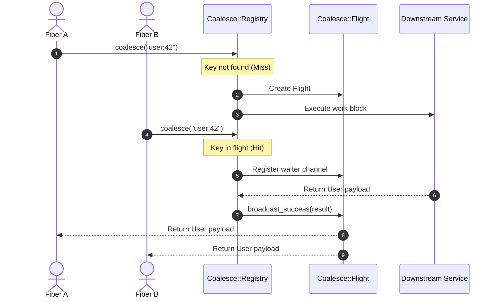

# cr-coalesce

[](https://github.com/Gwash3189/cr-coalesce/actions/workflows/ci.yml)
[](https://github.com/Gwash3189/cr-coalesce/releases)
[](https://opensource.org/licenses/MIT)

A lightweight, zero-dependency Crystal singleflight and request coalescing library with optional TTL caching, fluent builder, and declarative macro-wrapped instance methods.

Inspired by Go's [`singleflight`](https://pkg.go.dev/golang.org/x/sync/singleflight) and TypeScript's [`@gwash3189/coalesce`](https://github.com/Gwash3189/coalesce), `cr-coalesce` deduplicates concurrent in-flight asynchronous operations sharing the same key so downstream databases, external APIs, and expensive calculations are only hit once during traffic spikes or cache stampedes.

---

## Features

- **Concurrent In-Flight Coalescing**: When multiple fibers request the same key concurrently, only **one** execution runs downstream; all other callers wait and receive the shared result.
- **Declarative Macro API**: Simply `include Coalesce` and declare `coalesce` on instance methods with flexible proc, symbol, or default key generation.
- **Fluent Builder API**: Chain `.key(...)`, `.ttl(...)`, `.on_hit(...)`, `.on_miss(...)`, and `.work { ... }`.
- **Direct Block API**: Lightweight `Coalesce.coalesce(key) { ... }` or `Coalesce.singleflight(key) { ... }`.
- **Optional TTL Caching**: Cache resolved results for a duration (`Time::Span` or numeric milliseconds) to protect against rapid repeated queries.
- **Fail-Fast Error Propagation**: If downstream work raises an exception, the failure is broadcast to all waiting callers and the key is evicted immediately (errors are never cached).
- **Thread-Safe & Fiber-Native**: Engineered for Crystal's CSP concurrency model using buffered channels and mutexes with zero race conditions.

---

## Installation

Add this to your application's `shard.yml`:

```yaml
dependencies:
  cr-coalesce:
    github: Gwash3189/cr-coalesce
```

Then install dependencies:

```bash
shards install
```

---

## Usage

### 1. Declarative Macro API (`include Coalesce`)

Wrap any instance method to automatically deduplicate concurrent invocations:

```crystal
require "cr-coalesce"

class UserRepository
  include Coalesce

  # Key generated from method arguments via a Proc:
  coalesce key: ->(id : String) { "user:#{id}" },
    method: :fetch_user,
    ttl: 30.seconds,
    on_hit: :record_hit,
    on_miss: :record_miss

  def fetch_user(id : String) : User
    # Hit downstream database or API
    Database.users.find(id)
  end

  private def record_hit(key : String)
    Log.info { "Shared in-flight or cached result for #{key}" }
  end

  private def record_miss(key : String)
    Log.info { "Executing fresh work for #{key}" }
  end
end
```

#### Flexible Key Options

The macro supports multiple key strategies:

- **Proc literal**:
  ```crystal
  coalesce key: ->(id : String) { "user:#{id}" }, method: :fetch_user
  ```
- **Instance method symbol**:
  ```crystal
  coalesce method: :search, key: :build_search_key

  def build_search_key(query : String, tags : Array(String)) : String
    "search:#{query}:#{tags.join(",")}"
  end
  ```
- **Static String**:
  ```crystal
  coalesce :trending_topics, key: "global_trending", ttl: 1.minute
  ```
- **Automatic Default Key**:
  If `key:` is omitted, `cr-coalesce` automatically constructs a key from `ClassName#method_name(args)`:
  ```crystal
  coalesce :calculate_stats
  ```

---

### 2. Direct Block API (`Coalesce.coalesce` / `singleflight`)

Wrap arbitrary code blocks anywhere in your application:

```crystal
require "cr-coalesce"

# Concurrent calls share a single execution
results = Coalesce.coalesce("exchange_rates", ttl: 10.seconds) do
  fetch_rates_from_api
end

# Alias: singleflight
user = Coalesce.singleflight("user:42") do
  db.query_user(42)
end
```

---

### 3. Fluent Builder API

Construct coalesced operations with chaining and lifecycle hooks:

```crystal
require "cr-coalesce"

profile = Coalesce.key("profile:42")
  .ttl(5.seconds)
  .timeout(2.seconds)
  .on_hit { |key| Log.info { "Hit: #{key}" } }
  .on_miss { |key| Log.info { "Miss: #{key}" } }
  .work do
    fetch_user_profile(42)
  end
```

---

### Management & Inspection

```crystal
# Check if work is actively executing
Coalesce.in_flight?("user:42") # => Bool

# Check if a valid unexpired cached result exists
Coalesce.cached?("user:42") # => Bool

# Evict a specific key immediately
Coalesce.invalidate("user:42") # => Bool

# Clear all in-flight and cached entries
Coalesce.reset # => Nil
```

---

## How It Works



1. **Stampede Deduplication**: The first fiber to request a key starts the downstream task. Any fibers arriving concurrently for the same key suspend on a channel without hitting downstream systems.
2. **Result Broadcast**: When the first fiber completes, all waiting fibers receive the result and resume execution.
3. **Automatic Cleanup on Failure**: If downstream work raises an exception, the error is immediately broadcast to all waiters and the key is evicted so subsequent calls can retry without delay.
4. **Optional TTL Caching**: If `ttl` is configured, successful results remain cached for subsequent callers within the TTL window.

---

## Benchmarks

Benchmark executed on Crystal 1.21.0 (Apple M-series):

```
                                                    user     system      total        real
sequential direct coalesce                      0.004661   0.000447   0.005108 (  0.006188) # ~1.6M ops/sec
concurrent singleflight stampede (100 fibers)   0.008699   0.004592   0.013291 (  0.009616) # ~10k stampedes/sec
macro wrapped method (cached hit)               0.002534   0.000711   0.003245 (  0.002515) # ~4.0M ops/sec
```

Run benchmarks locally:

```bash
crystal run bench/coalesce_bench.cr --release
```

---

## Development & Testing

Ensure you have Crystal >= 1.21 installed.

```bash
# Run test suite
crystal spec --error-on-warnings

# Check formatting
crystal tool format --check src spec bench

# Run with multiple worker threads
CRYSTAL_WORKERS=4 crystal spec --error-on-warnings
```

---

## Contributing

1. Fork the repository (<https://github.com/Gwash3189/cr-coalesce/fork>)
2. Create your feature branch (`git checkout -b my-new-feature`)
3. Commit your changes (`git commit -am 'Add some feature'`)
4. Push to the branch (`git push origin my-new-feature`)
5. Create a new Pull Request

---

## License

MIT License. Copyright (c) 2026 Adam Beck.
